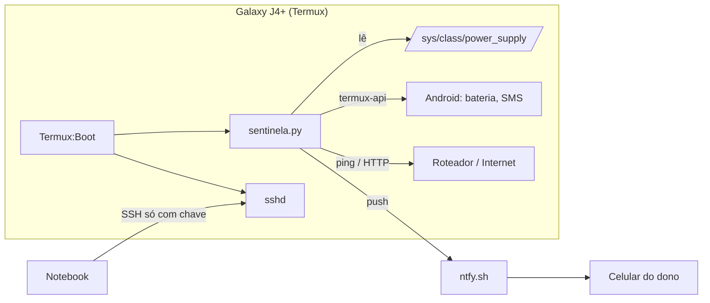

# Sentinela J4

Transforma um celular Android antigo num **monitor 24/7 da casa**: detecta queda de energia, queda do roteador e da internet, e manda alertas push para o celular do dono.

Feito num **Samsung Galaxy J4+ (SM-J415G)** com a tela quebrada, que estava parado na gaveta. Ele roda sem tela ("headless"), controlado por SSH, e se coloca de pé sozinho depois de qualquer reinício.

## Por que um celular?

Um celular velho tem coisas que um Raspberry Pi não tem de fábrica:

- **bateria embutida**: funciona como nobreak, então percebe a queda de energia e continua vivo;
- **Wi-Fi, sensores e (opcionalmente) modem 4G** para mandar SMS mesmo sem internet;
- **custo zero**: o aparelho já estava encostado.

## O que ele faz

| Vigia | Como detecta |
|---|---|
| Energia | o carregador deixa de aparecer como conectado (`termux-battery-status`) |
| Roteador | `ping` no IP do roteador |
| Internet | requisição HTTP a um endpoint de checagem de conectividade |
| Bateria | tensão real e temperatura lidas do driver do kernel |

- Um alerta só dispara depois de **3 leituras seguidas** iguais, o que evita alarme falso por um ping perdido.
- Avisa tanto a **queda** quanto a **volta** de cada serviço.
- **Fila offline:** se não há internet para mandar o alerta, ele guarda e reenvia tudo junto, com horário, quando a conexão volta.
- **Limitador de carga:** com root, segura a bateria em ~70% para o aparelho poder ficar na tomada 24/7 sem desgastar.
- **SMS (opcional):** com chip, alerta por SMS e responde aos comandos `status`, `bateria`, `log` e `ping`, aceitando só o número do dono.

## Arquitetura



## Descobertas no caminho

Algumas coisas que só aparecem mexendo no hardware real:

- **A ROM mentia a tensão.** O `voltage_now` reportava 2,56 V com a bateria a 58%, o que é impossível: uma célula de lítio desliga perto de 3,4 V. O valor real estava em `batt_inbat_voltage`, um arquivo do driver da Samsung. O script usa esse.
- **A porcentagem não é confiável.** Ela oscilava 7% em dois minutos com a tensão parada, e chegou a "pular" de 58% para 38%. Por isso o alerta de bateria fraca olha a **tensão** (≤ 3,60 V), não a %.
- **A Samsung já tem limitador de carga.** O modo de loja (`store_mode`), feito para celulares de vitrine, para a carga em ~70%. No teste de uma noite inteira, a carga parou às 04:33 com o carregador ainda conectado, e o Android continuou vendo o carregador, então a detecção de queda de energia não foi afetada.
- **Logo na primeira manhã,** o Sentinela registrou uma queda real do roteador, que ficou 20 minutos fora do ar.

## Instalação

Pré-requisitos no celular: **Termux**, **Termux:API** e **Termux:Boot**, todos pelo F-Droid (não misture com versões da Play Store).

```sh
pkg install python termux-api openssh tmux
```

1. Copie `sentinela.py` para o `~` do Termux.
2. Copie `sentinela.exemplo.json` para `~/sentinela.json` e preencha:
   - `ntfy_topico`: um nome difícil de adivinhar. Ele funciona como senha: quem souber o nome lê os alertas. Gere um com
     `python -c "import secrets; print('sentinela-' + secrets.token_hex(5))"`.
   - `roteador`: o IP do seu roteador (`ip route | grep default`).
   - `limitar_carga`: `true` só em Samsung com root, e depois de testar.
3. Instale o app **ntfy** no seu celular principal e assine o mesmo tópico.
4. Para subir no boot, copie `scripts/start.sh` para `~/.termux/boot/start.sh` e abra o app Termux:Boot uma vez.
5. Nas configurações do Android, desative a otimização de bateria do Termux, Termux:API e Termux:Boot.

Para acompanhar: `tmux attach -t sentinela` (saia com `Ctrl+B` e depois `d`) ou `tail -f ~/sentinela.log`.

## Arquivos

| Arquivo | Para quê |
|---|---|
| `sentinela.py` | o monitor |
| `sentinela.exemplo.json` | modelo das configurações pessoais |
| `scripts/start.sh` | inicialização automática (Termux:Boot) |
| `scripts/batlog.sh` | registra a bateria a cada 10 s, usado nos testes de carga |

## Segurança

- `sentinela.json` está no `.gitignore`: tópico do ntfy e número de telefone nunca vão para o repositório.
- O SSH do celular aceita **só chave**, sem login por senha.
- Nada é exposto para a internet; o acesso é só pela rede local.

## Próximos passos

- [ ] Histórico em SQLite e uma página com gráfico de quedas por dia
- [ ] Foto pela câmera quando o acelerômetro detectar movimento
- [ ] Testar postmarketOS (Linux mainline) no aparelho

## Hardware usado

Samsung Galaxy J4+ (SM-J415G, j4primelte) · Snapdragon 425 (4× Cortex-A53 1,4 GHz) · 2 GB de RAM · 32 GB · Android 10 (ROM custom, kernel 32 bits) · root com Magisk

## Licença

MIT
